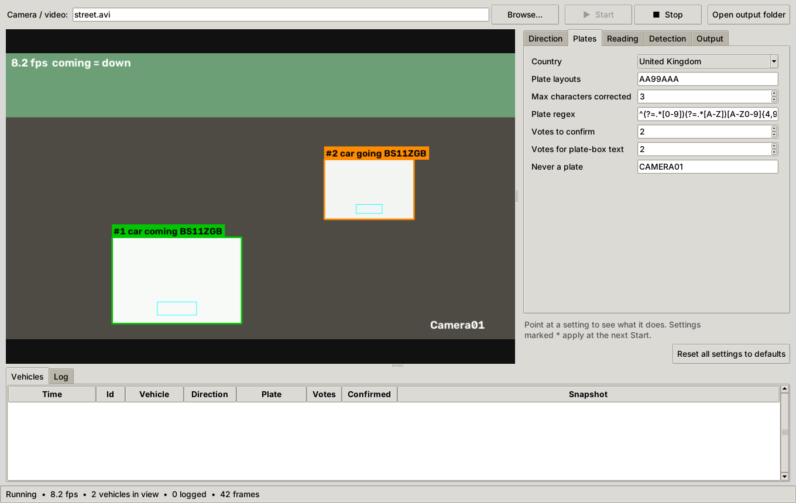

# Traffic monitor (RTSP + Mirage)

Reads an RTSP camera, detects vehicles with Mirage, reads their number plates
and decides whether each vehicle is **coming** towards the camera or **going**
away. Every vehicle that leaves the picture becomes one row in
`traffic_output/events.csv`, with a snapshot in `traffic_output/snapshots/`.

| File | What it is |
| --- | --- |
| `traffic_gui.py` | The window: live video, settings you can change while it runs, and the list of vehicles. **Start here.** |
| `traffic_monitor.py` | The engine. It also runs on its own from the command line, with settings at the top of the file. |
| `test_traffic_monitor.py` | Offline tests with a fake Mirage and a synthetic video. |
| `TrafficMonitor.sln`, `TrafficMonitor.pyproj` | Visual Studio solution and Python project. |
| `requirements.txt` | `cactus-compute`, `opencv-python`, `numpy`. |

## Open and run it in Visual Studio Community (no command line)

1. **Add Python support** (once). Open **Visual Studio Installer** from the
   Start menu, click **Modify** on Visual Studio Community, tick the
   **Python development** workload and click **Modify**. If you have no
   Python 3.9 or newer installed, also tick a Python 3 interpreter under
   **Individual components**.
2. **Open the project.** In Visual Studio choose **File > Open >
   Project/Solution...** and pick `examples\traffic_monitor\TrafficMonitor.sln`
   inside your clone.
3. **Create a virtual environment with the packages.** In **Solution
   Explorer**, right-click **Python Environments** > **Add Environment...**.
   Choose **Virtual environment**, leave the location as `env`, make sure
   **Install packages from file** points to `requirements.txt`, and click
   **Create**. Visual Studio installs everything and makes it the project's
   environment.
4. **Run it.** Press **F5**, or **Ctrl+F5** to run faster without the
   debugger. The Traffic Monitor window opens.

The first Start downloads the Cactus engine (a Windows x86-64 or ARM64 build
is published) and the Mirage weights from Hugging Face, then caches them.

## Using the window

* **Camera / video** at the top: an RTSP address such as
  `rtsp://127.0.0.1:8554/Streaming/Channels/101`, or **Browse...** for a
  recorded video, which is the easiest way to tune. Press **Start**.
* **Settings tabs** on the right: **Direction**, **Plates**, **Reading**,
  **Detection** and **Output**. A change takes effect on the next frame, so
  you can watch its effect on the video. Point at a setting to see what it
  does at the bottom of the panel. A value that is not allowed shows a red
  warning and the old value stays in use. Settings marked `*` (output folder,
  weights file) apply at the next Start.
* **Plates > Country** sets the plate format: **Germany** (the default), the
  UK or Turkey. German plates are matched with a pattern: district (1-3
  letters, Ä Ö Ü allowed), 1-2 letters, 1-4 digits, then E or H optionally,
  so "SB-FN 79E" is read as SBFN79E. Other layouts can be typed, with `A` for
  a letter and `9` for a digit.
* **Video speed:** for a camera, the video, the motion check and the overlay
  run at the stream's rate (up to **Output > Max video frames per second**,
  20 by default). Mirage runs alongside on the newest frame whenever it is
  free. The status bar shows both rates, for example "video 20 fps, Mirage
  1.5/s". Boxes follow the last frame Mirage finished, so they can trail a
  fast car slightly. A video file is analysed frame by frame instead, so a
  recording always gives the same result.
* **Vehicles** at the bottom lists each vehicle when it leaves the picture:
  green for coming, orange for going. Double-click a row to open its
  snapshot. **Log** shows status messages and, if switched on under
  **Output**, Mirage's raw output.
* Settings are saved to `traffic_settings.json` when you press Start and when
  you close the window. **Reset all settings to defaults** undoes everything.
  That file can contain your camera password, so it is kept out of git.

## Saving CPU: the motion gate

Mirage costs the same for every image it reads, whatever is in it, so the
saving comes from not calling it. With **Motion > Only run Mirage where things
move** on (the default):

1. The program keeps a **background image**: a small, blurred, greyscale
   picture of the empty scene that slowly follows daylight changes.
2. Every frame is compared with it, which takes about a millisecond. Pixels
   that differ by more than **Change that counts** are motion.
3. **No motion:** Mirage is skipped. Parked cars are part of the background,
   so they never trigger it.
4. **Motion:** only the moving area, plus a margin, is cut from the
   full-resolution frame and sent to Mirage. The car fills more of Mirage's
   input, so its plate reads better too. If motion covers most of the frame,
   the whole frame is sent.

The details that keep it reliable:

* A vehicle being followed is never learnt into the background, so a car
  waiting at a barrier keeps being read. Once it has not moved for **Parked
  after (s)** it counts as parked. It then gets no more plate reads, fades
  into the background, and is not logged unless it moved at some point.
* When a car that was in the first frame drives off, its old spot looks like
  motion (a "ghost"). Mirage finds no vehicle there, so that area fades into
  the background within a few frames (**Fade motion with no vehicle**).
* Half a parked car cut off at the edge of a crop is ignored, so it can't be
  mistaken for a moving vehicle.
* Changes that brighten or darken the whole picture (the camera's auto
  exposure, clouds) are cancelled out before comparing (**Ignore brightness
  changes**), so they don't look like motion everywhere.
* The camera's on-screen clock and name (Mirage calls them "watermark") never
  count as motion. If most of the frame changes at once (lights, the camera
  switching to night mode), the background starts again.
* **Show motion on the video** tints moving pixels red and outlines in yellow
  what Mirage reads. The status bar shows how often Mirage actually ran.
  **Reset background now** relearns the empty scene.

**Running the tests from menus:** **Test > Test Explorer**. If Visual
Studio asks, pick **pytest** as the framework and the project folder as the
root, then click **Run All**.

**Without the window:** right-click `traffic_monitor.py` in Solution
Explorer > **Set as Startup File**. It then uses the settings at the top of
that file, or the options in **Project > Properties > Debug > Script
Arguments**, for example `--approach up --plate-format AA99AAA --dump-json`.

**Using your clone's Cactus code instead of PyPI:** right-click **Search
Paths** in Solution Explorer > **Add Folder to Search Path...** and choose the
root folder of the clone. Also install the clone's `requirements.txt`
(`huggingface_hub`, `Pillow`) into the environment.

## Settings

The window shows all of these. Their names in `traffic_monitor.py`:

| Setting | Meaning |
| --- | --- |
| `SOURCE` | RTSP URL, a video file, or a webcam number such as `"0"`. A recording is the easiest way to tune. |
| `APPROACH` | Screen direction a vehicle moves in when it is coming towards you: `down`, `up`, `left`, `right`. |
| `PLATE_FORMATS` | Plate layouts, `A` = letter and `9` = digit, e.g. `("AA99AAA",)` for the UK. Reads are corrected position by position (BSLIZ6B becomes BS11ZGB). The best accuracy setting. Also `--plate-format AA99AAA`. |
| `PLATE_REGEX` | Used only when `PLATE_FORMATS` is empty: the plate after removing spaces and dashes. Default: `GERMAN_PLATE_REGEX`. `ANY_PLATE_REGEX` accepts any 4-9 letters and digits. |
| `IGNORE_TEXT`, `IGNORE_TEXT_IN` | Text that is never a plate (the camera name `CAMERA01`), and object names whose text is skipped (`watermark`). |
| `PLATE_WORDS`, `PLATE_BOX_VOTES` | Mirage detects "license plate" objects. Text inside one counts double, and the crop pass reads the plate box. |
| `DUPLICATE_OVERLAP`, `DUPLICATE_SIZE_RATIO` | When two vehicle boxes cover the same vehicle, the smaller one is dropped. |
| `PLATE_CONFIRM_VOTES` | Identical reads needed before a plate counts as confirmed. |
| `DUMP_JSON` | Prints Mirage's raw JSON for the first frames. Use it on your first run. |
| `BBOX_ORDER` | `xyxy` or `yxyx`. Switch it if boxes are drawn in the wrong place. |
| `CROP_PASS`, `CROP_EVERY`, `CROP_MIN_WIDTH` | Second, full-resolution read of an unconfirmed vehicle: at most one per Mirage pass, to the one that waited longest. Costs speed. |
| `MOTION_GATE`, `MOTION_*` | The motion gate described above (Motion tab). |
| `PARKED_SECONDS`, `PARKED_MOVE`, `LOG_PARKED` | When a vehicle counts as parked, and whether parked vehicles are logged. |
| `MAX_UNSEEN_SECONDS` | A vehicle outside the area Mirage read is logged and forgotten after this long. |
| `MAX_FPS`, `SHOW_WINDOW`, `OUTPUT_DIR` | Frame cap, preview window, and output folder. |

## First run checklist

1. **Turn on Output > Show Mirage's raw output** (`DUMP_JSON`) if detections look wrong.
   Checked on a real camera: objects come as `{"id", "name", "bbox"}`,
   text lines as `{"string", "bbox"}`, and boxes are `x0, y0, x1, y1` on a
   0-1000 grid. The parser already handles that.
2. **Check the boxes line up** with the vehicles in the preview. If they do
   not, set `BBOX_ORDER = "yxyx"`.
3. **Set `PLATE_FORMATS`** for your country, and add your camera's
   on-screen name to `IGNORE_TEXT`.
4. **Set `APPROACH`** by watching one vehicle come towards the camera.

## How direction and plates work

* **Direction** uses the whole life of a track. Moving in the `APPROACH`
  direction and getting bigger means *coming*. The reverse means *going*.
  Too little movement gives *unknown*. One frame can't tell motion, so
  this needs at least two frames of the same vehicle.
* **Plates** come from text Mirage reads inside a vehicle's box (double
  votes inside its "license plate" box), plus a second read of a
  full-resolution crop of the plate, because Mirage shrinks its input and
  plates are small. Each read is cleaned, fitted to the plate layouts
  (O/0, I/1, L/1, S/5, B/8, Z/2, G/6 are fixed by position) or checked
  against `PLATE_REGEX`, and votes. The most-voted plate wins.

Mirage is a general vision model, not a dedicated plate reader. Test it on
recordings from your own camera before relying on it, especially at night,
at a steep angle or at a distance.
